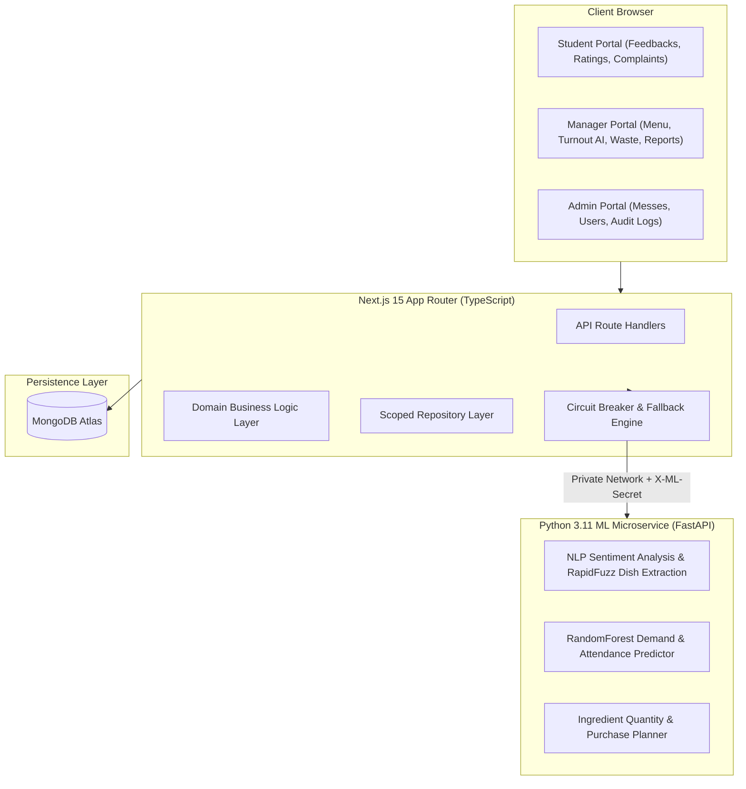

# MessInsight — Smart Mess & Canteen Feedback System

MessInsight is an intelligent, full-stack college mess management and feedback platform featuring real-time multilingual NLP sentiment analysis, meal demand forecasting, and food waste reduction.



---

## Key Highlights

- **Student Dining Portal**: View daily published menus, rate overall meals and specific dishes (1–5 stars), attach dish photos, report hygiene issues, and optionally submit anonymous feedback with strict student ID stripping.
- **Multilingual NLP Sentiment Engine**: TF-IDF + Logistic Regression model handling Hinglish phrases (`swadist`, `bakwas`, `kaccha`), emoji expansion, negation tagging, and RapidFuzz dish identification.
- **AI Turnout Forecasting**: Machine learning demand predictor using `RandomForestRegressor` with rolling historical attendance means, reducing prediction error by **91.6%** over naïve historical averages (**MAE: 3.52 students**).
- **Food Waste & Leftover Audits**: Ingredient consumption and leftover monitoring with automatic unaccounted variance calculations and sanitised CSV reporting.
- **Institutional Multi-Tenancy**: Granular Role-Based Access Control (RBAC) ensuring managers only access their designated canteen, backed by immutable audit logs with correlation IDs.

---

## Monorepo Structure

```
Mess_Insight/
├── apps/
│   └── web/                   # Next.js 15 (React 19, TypeScript, Tailwind CSS)
│       ├── src/
│       │   ├── app/           # App Router pages and API routes
│       │   ├── components/    # Reusable UI & custom SVG chart components
│       │   ├── server/        # Config, models, repositories, services, guards
│       │   └── tests/         # Vitest unit and integration test suites
├── services/
│   └── ml-service/            # Python 3.11 FastAPI ML microservice
│       ├── api/               # FastAPI route endpoints
│       ├── services/          # Sentiment and prediction inference logic
│       ├── datasets/          # Labeled datasets (DATA SOURCE: synthetic)
│       ├── artifacts/         # Serialized joblib model artifacts
│       └── tests/             # Pytest test suites
└── docs/                      # Architectural, ML, API, and deployment documentation
    ├── architecture.md
    ├── deployment.md
    ├── database.md
    ├── ml-methodology.md
    ├── security.md
    ├── metrics.md
    └── api.md
```

---

## Getting Started

### 1. Prerequisites
- **Node.js**: v20+ and `npm` or `pnpm`
- **Python**: v3.11+
- **MongoDB**: Local MongoDB instance or MongoDB Atlas connection string

### 2. Environment Setup

Copy example environment variables:
```bash
cp .env.example .env
```

Ensure `.env` contains:
```env
MONGODB_URI=mongodb://localhost:27017/messinsight
JWT_SECRET=your-minimum-32-characters-secure-jwt-secret-key-12345
INSTITUTE_EMAIL_DOMAIN=college.edu
ML_SERVICE_URL=http://localhost:8000
ML_SERVICE_SECRET=super-secret-ml-key-change-me
```

### 3. Launch the ML Microservice

```bash
cd services/ml-service
python -m venv .venv
# Windows:
.venv\Scripts\activate
# Linux/macOS:
source .venv/bin/activate

pip install -r requirements.txt
uvicorn app.main:app --host 0.0.0.0 --port 8000 --reload
```

### 4. Launch the Web Application

In another terminal:
```bash
cd apps/web
npm install
npm run dev
```

Visit [http://localhost:3000](http://localhost:3000) to access the application.

---

## Running Verification & Tests

### TypeScript Compile Check
```bash
cd apps/web
npx tsc --noEmit
```

### Web Core Unit Tests
```bash
cd apps/web
npx vitest run src/tests/env.test.ts src/tests/errors.test.ts src/tests/logger.test.ts src/tests/apiHandler.test.ts src/tests/health.test.ts
```

### Python ML Test Suite
```bash
cd services/ml-service
pytest tests/ -v
```

---

## Detailed Documentation

- [System Architecture](file:///docs/architecture.md)
- [REST API Specification](file:///docs/api.md)
- [Database Schema & ERD](file:///docs/database.md)
- [ML Methodology & Evaluation](file:///docs/ml-methodology.md)
- [Security & Threat Model](file:///docs/security.md)
- [Performance & SLAs](file:///docs/metrics.md)
- [Production Deployment Guide](file:///docs/deployment.md)

