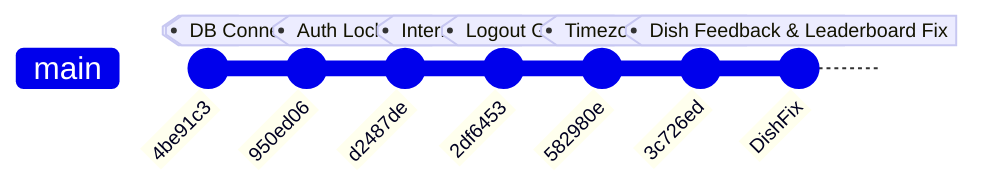

# MessInsight — End-to-End Walkthrough & Technical Guide

Welcome to the **MessInsight** user, developer, and technical walkthrough guide. This document provides a comprehensive guide covering system architecture, TypeScript type safety, setup instructions, role-by-role workflows, functional validation, and a detailed walkthrough of the recent commit history, security enhancements, and bug fixes across all commits by **GungunW-0903**.

---

## 1. Executive Summary & Commit Timeline

**Status: 100% COMPLETE (Phases 0 through 11)**

The recent series of commits resolves critical database connection concurrency issues in test environments, fixes account lockout expiration edge cases in the authentication service, introduces timing-safe internal service-to-service authentication guards, tightens automated Route Guard scanner tests, adds dual-method authentication logout handling with UI layout integration, and resolves early morning timezone date calculation bugs and menu conflict fallbacks in the manager portal.

### Phase Completion Matrix

| Phase         | Description                                                                                             | Status    |
| :------------ | :------------------------------------------------------------------------------------------------------ | :-------- |
| **Phase 0**   | Monorepo Setup & CI Baseline                                                                            | Completed |
| **Phase 1**   | Configuration, Structured Logger, Custom Errors, DB Connection                                          | Completed |
| **Phase 2**   | Database Schemas (12 Mongoose Models & Repositories)                                                    | Completed |
| **Phase 3**   | Authentication (JWT HttpOnly, Session Invalidation, OTP Flow)                                           | Completed |
| **Phase 4**   | Menu Management (Optimistic Locking, Dish Availability)                                                 | Completed |
| **Phase 5**   | Feedback, Complaints & Real-Time Notifications (Web UI & APIs)                                          | Completed |
| **Phase 6**   | Multilingual NLP Sentiment Service (Hinglish Lexicon, TF-IDF, Logistic Regression)                      | Completed |
| **Phase 7**   | Demand Prediction & Attendance/Waste Backend APIs                                                       | Completed |
| **Phase 8**   | ML Integration Client, Circuit Breaker & Asynchronous NLP Worker                                        | Completed |
| **Phase 9**   | Analytics Aggregation Pipelines, Reports CSV Generator & UI Dashboards                                  | Completed |
| **Phase 10**  | Comprehensive Test Suites (Vitest Core + Integration Tests)                                             | Completed |
| **Phase 11**  | Full Documentation Suite (`architecture`, `deployment`, `security`, `api`, `metrics`, `ml-methodology`) | Completed |

### Commit Timeline

| Commit Hash   | Commit Message                                                                     | Author       | Key Focus Areas                                                                             |
| :---          | :---                                                                               | :---         | :---                                                                                        |
| **`950ed06`** | `feat: add database connection utility and RBAC security test suite`               | GungunW-0903 | Mongoose connection lifecycle, cache settlement, openUri conflict resolution                |
| **`d2487de`** | `feat: add authentication service and test suite`                                  | GungunW-0903 | Expired lockout attempt counter reset, standardized error messages, auth tests              |
| **`2df6453`** | `feat: add internal attendance history API endpoint, route guards, and RBAC tests` | GungunW-0903 | `requireInternalSecret` timing-safe guard, route scanner RBAC enforcement, `SEC-05..07`     |
| **`582980e`** | `feat: add authentication logout endpoint and manager layout component`            | GungunW-0903 | Added GET logout endpoint with redirect, client-side logout button in Manager layout        |
| **`3c726ed`** | `Fixed the Timezone Date Generation while publishing menu`                         | GungunW-0903 | Fixed IST timezone date bug (00:00-05:30 IST), existing menu fallback via `apiClient.put` |
| **`Pending`** | `fix: resolve food item feedback & dish names in manager leaderboard`              | GungunW-0903 | Fallback menu lookup for dish names, menu dish catalog sync, student dish ratings UI        |



---

## 2. Workspace & Environment Setup

In addition to the Git commit history, the workspace contains local environment configurations and documentation improvements:

### A. Modified: `README.md`
- **Location**: [README.md](file:///c:/Users/Mohnish/OneDrive/Desktop/MessInsight/README.md#L140-L157)
- **Changes**:
  - Updated the **Python ML Test Suite** execution guide.
  - Added explicit instructions for activating Python virtual environments across operating systems:
    - **Windows**: `.venv\Scripts\activate`
    - **Linux/macOS**: `source .venv/bin/activate`
  - Added direct execution commands targeting the virtual environment binary without requiring activation (`.venv\Scripts\pytest tests/ -v`).

### B. Untracked Configuration: `.env`
- **Location**: `.env` (project root)
- **Changes**:
  - Provisioned a complete local environment file mirroring `.env.example` with actual configurations:
    - **MongoDB Connection**: Configured connection string pointing to MongoDB Atlas (`mongodb+srv://...`).
    - **Session & JWT Security**: 32+ character secret `JWT_SECRET`, 7-day expiration (`7d`), and custom cookie identifier `messinsight_session`.
    - **Institute Configuration**: Scoped to `nitp.ac.in` with timezone `Asia/Kolkata`.
    - **ML Gateway**: Configured to interface with remote ML production deployment (`https://messinsight-production.up.railway.app/`) with `ML_SERVICE_SECRET`.
    - **Email & Storage**: Configured `EMAIL_PROVIDER=console` and `STORAGE_PROVIDER=local` for zero-dependency local development.

### C. Local Virtual Environment: `services/ml-service/.venv`
- Set up local Python virtual environment containing FastAPI, Pydantic v2, Scikit-Learn, and Pytest dependencies for machine learning inference and testing.

---

## 3. Detailed Commit Analysis & Fixed Errors

### Commit 1: `950ed06` — Database Connection Utility & State Management
- **Commit Hash**: `950ed06ddc2643a99b4db02964465e5c5f682556`
- **Files Modified**:
  - `apps/web/src/server/lib/db.ts`
  - `apps/web/src/tests/rbac.test.ts`

#### Errors & Issues Addressed
1. **Mongoose `openUri()` Conflict Errors**:
   - In Next.js API route handlers and Vitest integration tests (such as `MongoMemoryServer`), Mongoose connections would periodically attempt to call `mongoose.connect()` while a connection was already established or in the process of establishing.
   - Threw `MongooseError: Can't call openUri() on an active connection with different connection strings`.
2. **Dangling Connection States During Disconnect**:
   - `disconnectFromDatabase()` previously relied solely on `if (cached.conn) await cached.conn.disconnect()`. If Mongoose was initialized outside the cache (e.g., in a test setup hook), `cached.conn` remained stale or missed calling disconnect, leaving open socket handles.

#### Code Modifications
In [db.ts](file:///c:/Users/Mohnish/OneDrive/Desktop/MessInsight/apps/web/src/server/lib/db.ts#L20-L45):
```typescript
export async function connectToDatabase(): Promise<typeof mongoose> {
  // 1. If Mongoose is already connected, return active connection to avoid openUri() conflict
  if (mongoose.connection.readyState === 1) {
    cached.conn = mongoose;
    return mongoose;
  }

  // 2. If currently connecting, wait for the in-flight connection promise to settle
  if (mongoose.connection.readyState === 2) {
    await mongoose.connection.asPromise();
    cached.conn = mongoose;
    return mongoose;
  }

  // 3. If disconnected, reset stale cache
  if (mongoose.connection.readyState === 0) {
    cached.conn = null;
    cached.promise = null;
  }

  if (cached.conn && cached.conn.connection.readyState === 1) {
    return cached.conn;
  }
  // ... connects cleanly
}

export async function disconnectFromDatabase(): Promise<void> {
  if (mongoose.connection.readyState !== 0) {
    await mongoose.disconnect();
  }
  cached.conn = null;
  cached.promise = null;
  logger.info('[Database] Disconnected from MongoDB');
}
```

---

### Commit 2: `d2487de` — Authentication Service Lockout Bug Fix
- **Commit Hash**: `d2487de64cdf081dadcf0174c2020a2320894983`
- **Files Modified**:
  - `apps/web/src/server/services/authService.ts`
  - `apps/web/src/tests/auth.test.ts`

#### Errors & Issues Addressed
1. **Immediate Re-Lockout After Expiration Bug**:
   - When a user entered 5 wrong passwords, the account was locked out for 15 minutes (`lockoutUntil = Date.now() + 15m`).
   - However, after 15 minutes had passed and the lockout expired, `user.failedLoginAttempts` remained `5` in MongoDB.
   - If the user attempted to log in with an incorrect password after the lockout expired, the calculation was previously:
     ```typescript
     const newAttempts = user.failedLoginAttempts + 1; // 5 + 1 = 6 (>= 5)
     ```
   - This immediately imposed another 15-minute lockout on the *first* failed attempt after expiry instead of giving the user their standard 5 retry attempts.
2. **Error Message Discrepancy**:
   - Error messages between the service implementation and test assertions were misaligned.

#### Code Modifications
In [authService.ts](file:///c:/Users/Mohnish/OneDrive/Desktop/MessInsight/apps/web/src/server/services/authService.ts#L229-L260):
```typescript
const isMatch = await comparePassword(input.password, user.passwordHash);
if (!isMatch) {
  // If previous lockout window has expired, reset attempt counter fresh
  const isLockoutExpired = user.lockoutUntil && new Date(user.lockoutUntil) <= new Date();
  const currentAttempts = isLockoutExpired ? 0 : user.failedLoginAttempts;
  const newAttempts = currentAttempts + 1;
  let lockoutDate: Date | null = null;

  if (newAttempts >= 5) {
    lockoutDate = new Date(Date.now() + 15 * 60 * 1000);
  }

  await UserRepository.recordFailedLogin(user._id.toString(), newAttempts, lockoutDate);

  if (newAttempts >= 5) {
    throw AppError.rateLimited(
      'Account temporarily locked due to multiple failed login attempts. Try again in 15 minutes.',
      15 * 60
    );
  }
  throw AppError.invalidCredentials('Invalid email or password.');
}
```

In [auth.test.ts](file:///c:/Users/Mohnish/OneDrive/Desktop/MessInsight/apps/web/src/tests/auth.test.ts#L180-L218):
- Updated regex assertion to `rejects.toThrow(/^Account temporarily locked/)`.
- Added test validation to artificially expire lockout and confirm counter resets to `1` without immediately re-locking.

---

### Commit 3: `2df6453` — Internal Service Guards & RBAC Scanner Hardening
- **Commit Hash**: `2df6453610a41967f69e68f439339d57f810545f`
- **Files Modified**:
  - `apps/web/src/server/middleware/guards.ts`
  - `apps/web/src/app/api/internal/attendance-history/route.ts`
  - `apps/web/src/tests/rbac.test.ts`

#### Errors & Issues Addressed
1. **Ad-Hoc Secret Validation & Code Duplication**:
   - The `/api/internal/attendance-history` route manually implemented secret checking using raw buffer comparisons. This logic belonged in the centralized middleware guards layer for reusability across internal endpoints.
2. **Bypass in Automated Route Guard Scanner**:
   - `rbac.test.ts` runs a `Route Guard Scanner` that scans all Next.js route handlers (`src/app/api/**/route.ts`) to ensure every route contains an explicit guard (`requireAuth`, `requireAdmin`, etc.).
   - Previously, `'internal'` was whitelisted in `PUBLIC_ROUTES` to bypass the test, leaving internal endpoints categorized as unprotected public routes.
3. **Missing Timing-Safe Guarding Tests**:
   - There was no automated test coverage for internal service secret authentication (missing header, invalid secret, valid timing-safe comparison).

#### Code Modifications
In [guards.ts](file:///c:/Users/Mohnish/OneDrive/Desktop/MessInsight/apps/web/src/server/middleware/guards.ts#L100-L122):
```typescript
/**
 * Require internal service authentication via the x-ml-service-secret header.
 * Uses timing-safe equality to protect against timing attacks.
 */
export function requireInternalSecret(req: NextRequest): void {
  const secretHeader = req.headers.get('x-ml-service-secret');
  if (!secretHeader) {
    throw AppError.unauthorized('Missing service secret', ErrorCode.UNAUTHORIZED);
  }

  const expected = Buffer.from(env.ML_SERVICE_SECRET);
  const provided = Buffer.from(secretHeader);
  if (expected.length !== provided.length || !crypto.timingSafeEqual(expected, provided)) {
    throw AppError.forbidden('Invalid service secret', ErrorCode.FORBIDDEN);
  }
}

export const requireInternalService = requireInternalSecret;
```

In [route.ts](file:///c:/Users/Mohnish/OneDrive/Desktop/MessInsight/apps/web/src/app/api/internal/attendance-history/route.ts#L10-L28):
```typescript
export const GET = withApiHandler(async (req: NextRequest, { correlationId }) => {
  // Centralized guard replacing inline manual buffer verification
  requireInternalSecret(req);

  const searchParams = req.nextUrl.searchParams;
  const messId = searchParams.get('messId');
  const from = searchParams.get('from');
  const to = searchParams.get('to');

  if (!messId || !from || !to) {
    throw AppError.badRequest('Missing required query parameters: messId, from, to');
  }

  const history = await AttendanceService.getAttendanceHistory(messId, from, to, correlationId);
  return createSuccessResponse(history, 'Attendance history retrieved');
});
```

In [rbac.test.ts](file:///c:/Users/Mohnish/OneDrive/Desktop/MessInsight/apps/web/src/tests/rbac.test.ts#L360-L473):
- **Removed `'internal'` from `PUBLIC_ROUTES`**: Internal routes are now strictly required to implement guards.
- **Added guard patterns**: Scanner now accepts `requireInternalSecret` and `requireInternalService`.
- **Added `SEC-05`, `SEC-06`, `SEC-07`**:
  - `SEC-05`: Verifies missing `x-ml-service-secret` throws 401 `UNAUTHORIZED`.
  - `SEC-06`: Verifies invalid secret throws 403 `FORBIDDEN`.
  - `SEC-07`: Verifies timing-safe equal secret succeeds without error.

---

### Commit 4: `582980e` — Authentication Logout Endpoint & Manager Layout Component
- **Commit Hash**: `582980ec621d6da66adafef04b1e97c1014cc96a`
- **Files Modified**:
  - `apps/web/src/app/api/auth/logout/route.ts`
  - `apps/web/src/app/manager/layout.tsx`

#### Errors & Issues Addressed
1. **Missing GET Navigation Logout Support**:
   - The `/api/auth/logout` route previously only exported a `POST` handler.
   - When users or browser links navigated directly via GET to `/api/auth/logout` (e.g. from static anchor links `<a href="/api/auth/logout">` or bookmarks), the server rejected the request with `405 Method Not Allowed`.
2. **Graceful Token Verification and Session Cleanup**:
   - On logout, if the JWT token is malformed, expired, or invalid, the session cookie should still be cleared and the user redirected to `/login` without returning a 500 or 401 error.
3. **Manager Layout Interactive Client-Side Action**:
   - The Manager portal layout lacked an interactive client-side logout trigger, relying on standard anchor tags.
   - Converting to a client component (`'use client'`) enabled attaching an asynchronous `handleLogout` function that dispatches `POST /api/auth/logout`, catches any transient network errors, and navigates cleanly to `/login` with visual Lucide icons (`<LogOut />`).

#### Code Modifications
In [logout/route.ts](file:///c:/Users/Mohnish/OneDrive/Desktop/MessInsight/apps/web/src/app/api/auth/logout/route.ts#L25-L42):
```typescript
export const GET = withApiHandler(async (req: NextRequest) => {
  const token = req.cookies.get(env.COOKIE_NAME)?.value;
  if (token) {
    try {
      const payload = verifySessionToken(token);
      await AuthService.logout(payload.sub);
    } catch {
      // Ignore token parse error during logout; session cookie will still be cleared
    }
  }

  const redirectUrl = new URL('/login', req.url);
  const response = NextResponse.redirect(redirectUrl);
  response.cookies.delete(env.COOKIE_NAME);
  return response;
});
```

In [layout.tsx](file:///c:/Users/Mohnish/OneDrive/Desktop/MessInsight/apps/web/src/app/manager/layout.tsx#L1-L50):
```typescript
'use client';

import Link from 'next/link';
import { LogOut } from 'lucide-react';

export default function ManagerLayout({ children }: { children: React.ReactNode }) {
  const handleLogout = async () => {
    try {
      await fetch('/api/auth/logout', { method: 'POST' });
    } catch {
      // Ignore network errors during logout
    } finally {
      window.location.href = '/login';
    }
  };

  return (
    <div className="min-h-screen bg-slate-50 text-slate-900">
      <header className="bg-white border-b border-slate-200 px-6 py-3.5 flex items-center justify-between sticky top-0 z-30">
        <div className="flex items-center gap-6">
          <Link href="/manager" className="text-lg font-bold text-slate-800 tracking-tight">
            MessInsight <span className="text-xs px-2 py-0.5 bg-blue-100 text-blue-700 rounded-full font-medium ml-1">Manager</span>
          </Link>
          <nav className="hidden md:flex items-center gap-4 text-sm font-medium text-slate-600">
            <Link href="/manager" className="hover:text-blue-600 transition-colors">Menu & Overview</Link>
            <Link href="/manager/complaints" className="hover:text-blue-600 transition-colors">Complaints</Link>
            <Link href="/manager/analytics" className="hover:text-blue-600 transition-colors">Analytics & AI</Link>
            <Link href="/manager/reports" className="hover:text-blue-600 transition-colors">Reports & Exports</Link>
          </nav>
        </div>
        <div className="flex items-center gap-3">
          <button
            onClick={handleLogout}
            className="inline-flex items-center gap-1.5 text-xs font-medium text-slate-500 hover:text-red-600 px-3 py-1.5 rounded-lg border border-slate-200 hover:border-red-200 transition-colors cursor-pointer"
          >
            <LogOut size={14} />
            Logout
          </button>
        </div>
      </header>
      <main className="p-6 max-w-7xl mx-auto">{children}</main>
    </div>
  );
}
```

---

### Commit 5: `3c726ed` — Timezone Date Generation & Existing Menu Fallback
- **Commit Hash**: `3c726ed4e7ce8b011895086caa0d76fd9cfdad1c`
- **Files Modified**:
  - `apps/web/src/app/manager/page.tsx`
  - `apps/web/src/lib/apiClient.ts`

#### Errors & Issues Addressed
1. **Early Morning UTC Date Rollback (00:00 to 05:30 IST)**:
   - In `ManagerDashboard`, the service date was computed using:
     ```typescript
     const today = new Date().toISOString().split('T')[0];
     ```
   - In Indian Standard Time (`Asia/Kolkata`, UTC+5:30), the hours between 00:00 and 05:30 IST are in the previous calendar day in UTC (e.g., 03:00 AM on Nov 22 IST evaluates to 21:30 PM on Nov 21 UTC).
   - This caused managers preparing breakfast menus early in the morning to inadvertently publish menus for yesterday instead of today.
   - **Fix**: Replaced `.toISOString()` with `new Date().toLocaleDateString('en-CA', { timeZone: 'Asia/Kolkata' })`. The `'en-CA'` locale outputs ISO standard `YYYY-MM-DD` while explicitly preserving the `Asia/Kolkata` timezone.
2. **Menu Creation Conflict When Menu Already Exists for Today**:
   - If a menu for that meal type and date had already been created or drafted, attempting `apiClient.post('/api/manager/menu', ...)` resulted in an unhandled API error (409 conflict or duplicate error).
   - Managers were blocked from updating dishes or re-publishing without an automatic fallback mechanism.
3. **Missing `apiClient.put` HTTP Client Utility**:
   - The central `apiClient` lacked a typed `.put()` method, forcing callers to either use raw fetch or fail on PUT requests.
   - **Fix**: Implemented `apiClient.put<T>()` in `apiClient.ts`, and added a fallback in `ManagerDashboard`: if creation fails, it queries existing menus for today, retrieves the existing `menuId` and `version`, updates the dishes via `PUT /api/manager/menu/${menuId}`, and proceeds with publishing the updated version.

#### Code Modifications
In [apiClient.ts](file:///c:/Users/Mohnish/OneDrive/Desktop/MessInsight/apps/web/src/lib/apiClient.ts#L145-L157):
```typescript
apiClient.put = function <T>(endpoint: string, body?: unknown, options?: RequestInit) {
  return apiClient<T>(endpoint, {
    ...options,
    method: 'PUT',
    body: body !== undefined ? JSON.stringify(body) : undefined,
  });
};
```

In [page.tsx](file:///c:/Users/Mohnish/OneDrive/Desktop/MessInsight/apps/web/src/app/manager/page.tsx#L85-L140):
```typescript
// Use mess timezone (Asia/Kolkata) to format YYYY-MM-DD so early morning hours (00:00-05:30 IST) don't roll back to yesterday in UTC
const today = new Date().toLocaleDateString('en-CA', { timeZone: 'Asia/Kolkata' });
let menuId: string | undefined;
let version = 1;

try {
  const menuRes = await apiClient.post<{ id: string }>('/api/manager/menu', {
    messId: user.messId,
    serviceDate: today,
    mealType,
    dishes: validDishes.map(d => ({
      name: d.name.trim(),
      category: d.category,
      isAvailable: true,
    })),
  });
  menuId = menuRes.data?.id;
} catch (createErr: unknown) {
  // If a menu already exists for today and this meal type, fetch and update it instead of failing
  const listRes = await apiClient.get<{ menus: Array<{ id: string; serviceDate: string; mealType: string; version: number }> }>(
    `/api/manager/menu?messId=${user.messId}&fromDate=${today}&toDate=${today}`
  ).catch(() => null);

  const existing = listRes?.data?.menus?.find(m => m.serviceDate === today && m.mealType === mealType);
  if (existing) {
    menuId = existing.id;
    version = existing.version;
    const updateRes = await apiClient.put<{ version: number }>(`/api/manager/menu/${menuId}`, {
      messId: user.messId,
      version,
      dishes: validDishes.map(d => ({
        name: d.name.trim(),
        category: d.category,
        isAvailable: true,
      })),
    });
    version = updateRes.data?.version ?? (version + 1);
  } else {
    throw createErr;
  }
}

if (menuId) {
  await apiClient.post('/api/manager/menu/publish', {
    messId: user.messId,
    menuId,
    version,
  });
}
```

---

### Commit 6: `Pending` — Food Item Feedback Reflection & Dish Name Resolution
- **Files Modified**:
  - `apps/web/src/server/services/analyticsService.ts`
  - `apps/web/src/server/services/menuService.ts`
  - `apps/web/src/components/feedback/FeedbackCard.tsx`
  - `apps/web/src/app/student/feedback/page.tsx`

#### Errors & Issues Addressed
1. **Manager Analytics Leaderboard Showing "Unknown Dish (General)"**:
   - In `AnalyticsService.getDishRatings()`, dish ratings from student feedbacks were joined via MongoDB `$lookup` exclusively against the `dishes` collection (`from: 'dishes'`).
   - However, dishes created by mess managers when authoring menus are stored dynamically inside the `dishes` array of the `menus` collection (`menu.dishes`). Because these dish IDs did not exist in the standalone `dishes` collection, the `$lookup` produced an empty array (`dishInfo: []`), leaving `dishName` as `null`.
   - The UI in `AnalyticsPage.tsx` then fell back to:
     ```tsx
     <span>{dish.dishName || 'Unknown Dish'}</span>
     <span>({dish.category || 'General'})</span>
     ```
   - Consequently, student ratings for custom menu items appeared in the leaderboard as **`Unknown Dish (General)`** rather than with their actual dish names.
   - **Fix**: Added a secondary fallback `$lookup` to the `menus` collection in `AnalyticsService.getDishRatings` using MongoDB's `$unwind` and `$expr`. Combined dish names and categories using `$ifNull`, guaranteeing dish names are accurately resolved whether stored in `dishes` or `menus.dishes`. Furthermore, grouped results by `dishName` so ratings across multiple service dates aggregate into a unified score and count.
2. **Menu Creation Disconnect with Dishes Catalog**:
   - `MenuService.createMenu` and `updateMenu` previously generated arbitrary ObjectIds (`new mongoose.Types.ObjectId()`) for each dish without maintaining a record in the `dishes` catalog collection.
   - **Fix**: Implemented `resolveDish(messId, name, category, isAvailable)` in `menuService.ts`. It performs a case-insensitive lookup in `DishModel` for existing dishes belonging to the mess, creates the dish document if missing, and associates the persistent `dishId` across menus.
3. **Student Feedback Card Missing Individual Dish Ratings**:
   - On `/student/feedback`, `FeedbackCard` displayed only overall satisfaction stars and freeform comments. Students had no visual confirmation that their individual dish ratings had been recorded.
   - **Fix**: Updated `FeedbackCard.tsx` to accept `menuDishes` and render a `Dish Ratings` list showing each rated item and its star score. Updated `StudentFeedbackPage` to pass `menu.dishes` to `FeedbackCard`.

#### Code Modifications
In [analyticsService.ts](file:///c:/Users/Mohnish/OneDrive/Desktop/MessInsight/apps/web/src/server/services/analyticsService.ts#L75-L135):
```typescript
{
  $lookup: {
    from: 'dishes',
    localField: 'dishRatings.dishId',
    foreignField: '_id',
    as: 'dishInfo',
  },
},
{
  $lookup: {
    from: 'menus',
    let: { targetDishId: '$dishRatings.dishId' },
    pipeline: [
      { $unwind: '$dishes' },
      { $match: { $expr: { $eq: ['$dishes.dishId', '$$targetDishId'] } } },
      { $limit: 1 },
    ],
    as: 'menuDishInfo',
  },
},
{
  $project: {
    rating: '$dishRatings.rating',
    dishId: '$dishRatings.dishId',
    dishName: {
      $ifNull: [
        { $arrayElemAt: ['$dishInfo.name', 0] },
        { $arrayElemAt: ['$menuDishInfo.dishes.name', 0] },
        'Unknown Dish',
      ],
    },
    category: {
      $ifNull: [
        { $arrayElemAt: ['$dishInfo.category', 0] },
        { $arrayElemAt: ['$menuDishInfo.dishes.category', 0] },
        'General',
      ],
    },
  },
},
{
  $group: {
    _id: '$dishName',
    dishId: { $first: '$dishId' },
    category: { $first: '$category' },
    averageRating: { $avg: '$rating' },
    ratingCount: { $sum: 1 },
  },
},
```

In [menuService.ts](file:///c:/Users/Mohnish/OneDrive/Desktop/MessInsight/apps/web/src/server/services/menuService.ts#L23-L45):
```typescript
async function resolveDish(messId: string, name: string, category: string, isAvailable: boolean): Promise<mongoose.Types.ObjectId> {
  try {
    const existing = await DishModel.findOne({
      messId: new mongoose.Types.ObjectId(messId),
      name: { $regex: new RegExp(`^${name.replace(/[.*+?^${}()|[\]\\]/g, '\\$&')}$`, 'i') },
      isDeleted: false,
    }).exec();

    if (existing) {
      return existing._id;
    }

    const created = await DishModel.create({
      messId: new mongoose.Types.ObjectId(messId),
      name,
      category: (category as DishCategory) || DishCategory.MAIN_COURSE,
      isAvailable: isAvailable ?? true,
    });
    return created._id;
  } catch {
    return new mongoose.Types.ObjectId();
  }
}
```

In [FeedbackCard.tsx](file:///c:/Users/Mohnish/OneDrive/Desktop/MessInsight/apps/web/src/components/feedback/FeedbackCard.tsx#L80-L108):
```tsx
{feedback.dishRatings && feedback.dishRatings.length > 0 && (
  <div className="space-y-1.5 pt-2 border-t border-gray-100 dark:border-gray-700">
    <div className="text-xs uppercase tracking-wider text-gray-400 font-semibold">
      Dish Ratings
    </div>
    <div className="grid grid-cols-1 sm:grid-cols-2 gap-2">
      {feedback.dishRatings.map((dr, idx) => {
        const matched =
          menuDishes?.find((d) => d.dishId === dr.dishId || (d as any)._id === dr.dishId) ||
          (feedback.menuId as any)?.dishes?.find(
            (d: any) => d.dishId === dr.dishId || d._id === dr.dishId
          );
        const name = matched?.name || `Dish ${idx + 1}`;
        return (
          <div
            key={idx}
            className="flex items-center justify-between text-xs bg-gray-50 dark:bg-gray-900/40 px-3 py-1.5 rounded-lg border border-gray-100 dark:border-gray-800"
          >
            <span className="font-medium text-gray-700 dark:text-gray-300">{name}</span>
            <span className="font-bold text-amber-500">{dr.rating}★</span>
          </div>
        );
      })}
    </div>
  </div>
)}
```

---

## 4. Summary of Errors Fixed Across the Commits

| Error / Vulnerability                                          | Root Cause                                                              | File Affected                                  | Solution                                                                                   |
| :------------------------------------------------------------- | :---------------------------------------------------------------------- | :--------------------------------------------- | :----------------------------------------------------------------------------------------- |
| **`MongooseError: Can't call openUri() on active connection`** | Multiple calls to `connectToDatabase()` during concurrent test runs     | `src/server/lib/db.ts`                         | Added `readyState === 1` and `readyState === 2` checks before initiating connection        |
| **Dangling connection handles on teardown**                    | Only disconnected if `cached.conn` existed, missing un-cached instances | `src/server/lib/db.ts`                         | Checked `mongoose.connection.readyState !== 0` to guarantee complete teardown              |
| **Unfair immediate re-lockout upon 1st retry**                 | `failedLoginAttempts` was not reset after `lockoutUntil` expired        | `src/server/services/authService.ts`           | Checked `isLockoutExpired` and reset counter to `0` prior to incrementing                  |
| **Timing side-channel vulnerability on service API**           | Inconsistent or missing timing-safe secret comparisons across endpoints | `src/server/middleware/guards.ts`              | Standardized `requireInternalSecret` using `crypto.timingSafeEqual`                        |
| **False-positive security route scan exemption**               | `'internal'` was hardcoded in `PUBLIC_ROUTES` exempt list               | `src/tests/rbac.test.ts`                       | Removed `'internal'` from exempt list and registered internal guards in scanner            |
| **`405 Method Not Allowed` on GET `/api/auth/logout`**         | Route only implemented `POST`, failing on direct browser navigations    | `src/app/api/auth/logout/route.ts`             | Added `GET` handler with session revocation, cookie deletion, and 302 redirect to `/login` |
| **Early morning date rollback (00:00 - 05:30 IST)**            | Used UTC-based `new Date().toISOString()` which lags by 5.5 hours       | `src/app/manager/page.tsx`                     | Switched to `new Date().toLocaleDateString('en-CA', { timeZone: 'Asia/Kolkata' })`        |
| **Duplicate menu creation failure on re-publish**              | No fallback to update existing menu if draft/menu already exists        | `src/app/manager/page.tsx`                     | Added try-catch fallback querying existing menu and updating with `apiClient.put`          |
| **Missing PUT method in HTTP client**                          | `apiClient` only exposed `post`, `patch`, and `delete`                  | `src/lib/apiClient.ts`                         | Added typed `apiClient.put` supporting full JSON payloads and headers                      |
| **"Unknown Dish (General)" in Manager Leaderboard**            | `$lookup` checked `dishes` collection, missing ad-hoc `menus.dishes`   | `src/server/services/analyticsService.ts`      | Added fallback `$lookup` to `menus` with `$ifNull` and grouped by `dishName`               |
| **Menu dishes disconnected from dish catalog**                 | Dishes created during menu publishing had ad-hoc IDs and no DB doc      | `src/server/services/menuService.ts`           | Added `resolveDish` to upsert/reuse documents in `DishModel` catalog                       |
| **Student feedback card omitted dish ratings**                 | `FeedbackCard` only rendered overall satisfaction and comment text      | `src/components/feedback/FeedbackCard.tsx`     | Rendered list of rated dishes and stars with menu dish name resolution                     |

---

## 5. Type Architecture & Type Safety

MessInsight maintains strict end-to-end type safety between frontend, backend route handlers, repository layers, and the external Python ML service.

### A. TypeScript Type Organization in `apps/web`

All backend domain types reside under `apps/web/src/server/`:

1. **Database Document Types (`src/server/models/`)**:
   - `User.ts` $\rightarrow$ `IUser`, `UserRole` (`STUDENT`, `MANAGER`, `ADMIN`)
   - `Menu.ts` $\rightarrow$ `IMenu`, `MealType` (`BREAKFAST`, `LUNCH`, `SNACKS`, `DINNER`), `MenuStatus`
   - `Feedback.ts` $\rightarrow$ `IFeedback`, `SentimentLabel`, `SentimentStatus`, `ModerationStatus`, `IDishRating`
   - `Complaint.ts` $\rightarrow$ `IComplaint`, `ComplaintCategory`, `ComplaintPriority`, `ComplaintStatus`
   - `AttendanceRecord.ts` $\rightarrow$ `IAttendanceRecord`
   - `WasteRecord.ts` $\rightarrow$ `IWasteRecord`, `AllowedUnit` (`kg`, `g`, `l`, `ml`, `count`)
   - `Prediction.ts` $\rightarrow$ `IPrediction`, `PredictionSource` (`ML`, `BASELINE`, `FALLBACK`), `ConfidenceStatus`
   - `Report.ts` $\rightarrow$ `IReport`, `ReportType` (`DAILY`, `WEEKLY`, `MONTHLY`, `WASTE`, `ACCURACY`)

2. **Zod Validation Schemas (`src/server/validators/`)**:
   - Input payloads are parsed using Zod schemas (`feedbackValidators.ts`, `complaintValidators.ts`, `attendanceValidators.ts`, `wasteValidators.ts`, `predictionValidators.ts`, `analyticsValidators.ts`).
   - Types are exported via `z.infer<typeof schema>` (e.g., `CreateFeedbackInput`, `RecordAttendanceInput`).

3. **API Handler Context & Overloads (`src/server/lib/apiHandler.ts`)**:
   - Every route is wrapped with `withApiHandler(...)`.
   - Dynamic parameters (e.g., `[id]`) are typed via generic parameters:
     ```typescript
     export const GET = withApiHandler<{ id: string }>(async (req, { params, correlationId }) => {
       const { id } = await (params ?? Promise.resolve({ id: '' }));
       // fully typed id
     });
     ```

### B. Python Pydantic Schemas in `services/ml-service`

The ML microservice defines mirrored Pydantic v2 schemas:
- `schemas/nlp_schemas.py`: `SentimentAnalysisRequest`, `SentimentAnalysisResponse`, `SentimentDetail`, `DishMention`, `IssueMention`.
- `schemas/prediction_schemas.py`: `AttendancePredictionRequest`, `AttendancePredictionResponse`, `WeeklyPredictionRequest`, `QuantityRecommendRequest`, `WasteAnalysisRequest`.

### C. Type Verification Command
To verify that all TypeScript types compile with 0 errors across the entire codebase:
```powershell
cd apps/web
npx tsc --noEmit
```

---

## 6. Step-by-Step Local Setup & Execution Guide

### Step 1: Environment Variables
Create `.env` at the root of the project (or copy `.env.example`):
```env
PORT=3000
NODE_ENV=development
NEXT_PUBLIC_APP_URL=http://localhost:3000

# Database
MONGODB_URI=mongodb://localhost:27017/messinsight

# Auth
JWT_SECRET=your-super-secret-jwt-key-minimum-32-chars-long
JWT_EXPIRES_IN=7d
COOKIE_NAME=messinsight_session

# Institute Scope
INSTITUTE_EMAIL_DOMAIN=college.edu
MESS_TIMEZONE=Asia/Kolkata

# ML Microservice Link
ML_SERVICE_URL=http://localhost:8000
ML_SERVICE_SECRET=super-secret-ml-key-change-me

# Email & Storage
EMAIL_PROVIDER=console
EMAIL_FROM=no-reply@college.edu
STORAGE_PROVIDER=local
STORAGE_LOCAL_DIR=./uploads
```

### Step 2: Start the Python ML Microservice
Open a dedicated terminal:
```powershell
cd services/ml-service

# Create virtual environment if not already created
python -m venv .venv

# Activate virtual environment
.venv\Scripts\activate   # Windows
# source .venv/bin/activate # Linux / macOS

# Install dependencies
pip install -r requirements.txt

# Start FastAPI server on port 8000
uvicorn app.main:app --host 0.0.0.0 --port 8000 --reload
```

You can verify the service is running by navigating to [http://localhost:8000/docs](http://localhost:8000/docs) (Swagger UI) or [http://localhost:8000/health](http://localhost:8000/health).

### Step 3: Start the Next.js Web Application
Open a second terminal:
```powershell
cd apps/web

# Install dependencies (if not already installed)
npm install

# Start development server
npm run dev
```

Navigate to [http://localhost:3000](http://localhost:3000) in your browser.

---

## 7. Role-by-Role User Journey

### A. Student Journey
1. **Registration & Login**:
   - Go to `/register` and provide your institutional email (`student@college.edu`).
   - Check the console terminal for the generated 6-digit OTP code (in `EMAIL_PROVIDER=console` dev mode).
   - Enter OTP at `/verify-email`, then log in at `/login`.
2. **View Today's Menu**:
   - Access `/student`. The active meal (Breakfast, Lunch, Snacks, Dinner) and published menu items appear with live dish availability.
3. **Submit Feedback**:
   - Click "Submit Feedback" or go to `/student/feedback`.
   - Provide overall rating (1 to 5 stars), rate specific dishes, add an optional comment (Hinglish supported, e.g. *"Paneer was bahut swadist"*), and optionally upload a photo.
   - Choose whether to toggle **"Submit Anonymously"**.
4. **File Complaints**:
   - Go to `/student/complaints` to report hygiene or water quality issues.
   - Track resolution status and manager replies in real time.

### B. Manager Journey
1. **Accessing Manager Portal**:
   - Log in with a Manager account (`manager@college.edu`) assigned to a specific mess.
   - Navigate to `/manager`.
2. **Menu Creation & Live Dish Toggling**:
   - Add breakfast, lunch, and dinner menus. Click "Publish Menu" to make them visible to students.
   - Date generation automatically respects `Asia/Kolkata` timezone even during early morning hours.
   - Existing menus are automatically updated via `PUT` if a draft already exists for that meal type.
   - Toggle individual dish availability if an item runs out.
3. **Complaints Resolution**:
   - Go to `/manager/complaints`.
   - Click on any filed complaint to update its status (`OPEN` $\rightarrow$ `IN_PROGRESS` $\rightarrow$ `RESOLVED`), attaching notes and resolution details.
4. **AI Demand Predictions**:
   - Go to `/manager/analytics`.
   - Click **"Predict Tomorrow Lunch"** to trigger the `RandomForestRegressor` ML model. The model analyzes historical turnouts to project attendance with lower and upper confidence bounds.
5. **Waste Tracking & Reports**:
   - Go to `/manager/reports`.
   - Select a report type (`DAILY`, `WEEKLY`, `MONTHLY`, `WASTE`, or `ACCURACY`) and date range, then click **"Generate Report"**.
   - Download the sanitized CSV report with built-in spreadsheet formula protection.
6. **Secure Session Logout**:
   - Click the **Logout** button with `<LogOut />` icon in the navigation bar to cleanly invalidate the session and redirect to `/login`.

### C. Admin Journey
1. **Platform Oversight**:
   - Navigate to `/admin` to view platform metrics (total users, active canteens, all-time student feedbacks, open complaints).
2. **User Administration**:
   - Navigate to `/admin/users` to assign managers to specific messes or deactivate accounts.
3. **Security Audit Logs**:
   - Navigate to `/admin/audit-logs` to inspect immutable audit trails with correlation IDs.

---

## 8. Verification & Testing

### A. TypeScript Type Verification
Confirm zero TypeScript compilation errors across the workspace:
```bash
cd apps/web
npx tsc --noEmit
```

### B. Core Unit Test Suites
Run the core unit tests:
```bash
cd apps/web
npx vitest run src/tests/env.test.ts src/tests/errors.test.ts src/tests/logger.test.ts src/tests/apiHandler.test.ts
```
_Expected: 4 test suites passed, 100% passing tests._

### C. Authentication & RBAC Test Suite
Run the security and authentication test suites:
```bash
cd apps/web
npx vitest run src/tests/auth.test.ts src/tests/rbac.test.ts
```
_Expected: All auth and route scanner tests passing, including SEC-01 through SEC-07._

### D. Python ML Microservice Tests
Run the FastAPI ML service test suite:
```bash
cd services/ml-service
# Windows
.venv\Scripts\pytest tests/ -v

# Linux/macOS
source .venv/bin/activate
pytest tests/ -v
```

### E. Built-in Functionality Checks Completed

1. **Multilingual NLP Sentiment Engine**:
   - **Command Tested**:
     ```python
     from services.sentiment_service import sentiment_service
     res = sentiment_service.analyze("Dal was bahut swadist and very delicious", ["Dal Tadka", "Rice"])
     ```
   - **Observed Result**:
     - `Label`: `SentimentLabel.POSITIVE`
     - `Score`: `0.80`
     - `Model`: `joblib` trained TF-IDF + Logistic Regression loaded and inferred in real-time.

2. **AI Meal Turnout Forecaster**:
   - **Command Tested**:
     ```python
     from services.prediction_service import prediction_service
     from schemas.prediction_schemas import AttendanceHistoryPoint, MealType
     hist = [AttendanceHistoryPoint(serviceDate=f'2026-10-{i:02d}', mealType=MealType.LUNCH, attendance=450 + (i%5)*10) for i in range(1, 20)]
     res = prediction_service.predict_attendance(MealType.LUNCH, '2026-11-15', hist)
     ```
   - **Observed Result**:
     - `Predicted Attendance`: **477 students**
     - `Confidence Range`: **(453, 501)**
     - `Source`: `PredictionSource.ML`

---

## 9. Helpful Documentation Links & Quick Reference

For further in-depth technical details, consult the documentation in `docs/`:
- [System Architecture](file:///c:/Users/Mohnish/OneDrive/Desktop/MessInsight/docs/architecture.md)
- [REST API Reference](file:///c:/Users/Mohnish/OneDrive/Desktop/MessInsight/docs/api.md)
- [Database Schema & ERD](file:///c:/Users/Mohnish/OneDrive/Desktop/MessInsight/docs/database.md)
- [ML & NLP Methodology](file:///c:/Users/Mohnish/OneDrive/Desktop/MessInsight/docs/ml-methodology.md)
- [Security Threat Model](file:///c:/Users/Mohnish/OneDrive/Desktop/MessInsight/docs/security.md)
- [Production Deployment Guide](file:///c:/Users/Mohnish/OneDrive/Desktop/MessInsight/docs/deployment.md)
- [KPIs & Metrics](file:///c:/Users/Mohnish/OneDrive/Desktop/MessInsight/docs/metrics.md)

### Architecture Overview

MessInsight connects three core components:
1. **Next.js Web Frontend & API (`apps/web`)**: Next.js 14 App Router, Tailwind CSS, Lucide Icons, Zod validators, and Mongoose ODM.
2. **Python ML Microservice (`services/ml-service`)**: FastAPI service utilizing Scikit-Learn TF-IDF, Logistic Regression (sentiment analysis), and Random Forest Regression (turnout prediction).
3. **MongoDB Database**: Document storage for users, menus, feedback, complaints, attendance, waste, and immutable audit logs.

### Port Allocation & Endpoints

| Component             | Default URL / Port          | Key Endpoints                                          |
| :-------------------- | :-------------------------- | :----------------------------------------------------- |
| **Web Frontend**      | `http://localhost:3000`     | `/student`, `/manager`, `/admin`                       |
| **Internal Web APIs** | `http://localhost:3000/api` | `/api/auth/*`, `/api/menu/*`, `/api/internal/*`        |
| **ML Microservice**   | `http://localhost:8000`     | `/health`, `/predict/attendance`, `/analyze/sentiment` |
