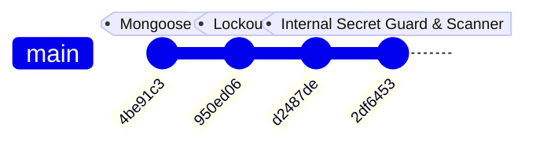

# MessInsight — End-to-End Walkthrough & User Guide

# MessInsight — Comprehensive Changes & Commits Walkthrough

Welcome to the **MessInsight** user and developer walkthrough guide. This document provides a complete guide on system architecture, TypeScript type safety, setup instructions, role-by-role workflows, and functional validation.
This document provides a complete technical walkthrough of the recent commit history, bug fixes, security enhancements, and workspace modifications in **MessInsight**, covering the three commits by **GungunW-0903** and the working directory changes.

---

## 1. Project Overview & Current Completion Status

## 1. Executive Summary & Commit Timeline

**Status: 100% COMPLETE (Phases 0 through 11)**
The recent series of commits resolves critical database connection concurrency issues in test environments, fixes account lockout expiration edge cases in the authentication service, introduces timing-safe internal service-to-service authentication guards, and tightens the automated Route Guard Scanner.

| Phase         | Description                                                                                             | Status       |
| :------------ | :------------------------------------------------------------------------------------------------------ | :----------- |
| **Phase 0**   | Monorepo Setup & CI Baseline                                                                            | Completed    |
| **Phase 1**   | Configuration, Structured Logger, Custom Errors, DB Connection                                          | Completed    |
| **Phase 2**   | Database Schemas (12 Mongoose Models & Repositories)                                                    | Completed    |
| **Phase 3**   | Authentication (JWT HttpOnly, Session Invalidation, OTP Flow)                                           | Completed    |
| **Phase 4**   | Menu Management (Optimistic Locking, Dish Availability)                                                 | Completed    |
| **Phase 5**   | Feedback, Complaints & Real-Time Notifications (Web UI & APIs)                                          | Completed    |
| **Phase 6**   | Multilingual NLP Sentiment Service (Hinglish Lexicon, TF-IDF, Logistic Regression)                      | Completed    |
| **Phase 7**   | Demand Prediction & Attendance/Waste Backend APIs                                                       | Completed    |
| **Phase 8**   | ML Integration Client, Circuit Breaker & Asynchronous NLP Worker                                        | Completed    |
| **Phase 9**   | Analytics Aggregation Pipelines, Reports CSV Generator & UI Dashboards                                  | Completed    |
| **Phase 10**  | Comprehensive Test Suites (Vitest Core + Integration Tests)                                             | Completed    |
| **Phase 11**  | Full Documentation Suite (`architecture`, `deployment`, `security`, `api`, `metrics`, `ml-methodology`) | Completed    |
| Commit Hash   | Commit Message                                                                                          | Author       | Key Focus Areas                                                                         |
| :---          | :---                                                                                                    | :---         | :---                                                                                    |
| **`950ed06`** | `feat: add database connection utility and RBAC security test suite`                                    | GungunW-0903 | Mongoose connection lifecycle, cache settlement, openUri conflict resolution            |
| **`d2487de`** | `feat: add authentication service and test suite`                                                       | GungunW-0903 | Expired lockout attempt counter reset, standardized error messages, auth tests          |
| **`2df6453`** | `feat: add internal attendance history API endpoint, route guards, and RBAC tests`                      | GungunW-0903 | `requireInternalSecret` timing-safe guard, route scanner RBAC enforcement, `SEC-05..07` |



---

## 2. Type Architecture & How to Proceed with Types

## 2. Workspace & Untracked / Working Directory Changes

MessInsight maintains strict end-to-end type safety between frontend, backend route handlers, repository layers, and the external Python ML service.
In addition to the Git commit history, the workspace contains local environment configurations and documentation improvements:

### A. TypeScript Type Organization in `apps/web`

### A. Modified: `README.md`

- **Location**: [README.md](file:///c:/Users/Mohnish/OneDrive/Desktop/MessInsight/README.md#L140-L157)
- **Changes**:
  - Updated the **Python ML Test Suite** execution guide.
  - Added explicit instructions for activating Python virtual environments across operating systems:
    - **Windows**: `.venv\Scripts\activate`
    - **Linux/macOS**: `source .venv/bin/activate`
  - Added direct execution commands targeting the virtual environment binary without requiring activation (`.venv\Scripts\pytest tests/ -v`).

All backend domain types reside under `apps/web/src/server/`:

### B. Untracked Configuration: `.env`

- **Location**: `.env` (project root)
- **Changes**:
  - Provisioned a complete local environment file mirroring `.env.example` with actual configurations:
    - **MongoDB Connection**: Configured connection string pointing to MongoDB Atlas (`mongodb+srv://...`).
    - **Session & JWT Security**: 32+ character dummy secret `JWT_SECRET`, 7-day expiration (`7d`), and custom cookie identifier `messinsight_session`.
    - **Institute Configuration**: Scoped to `nitp.ac.in` with timezone `Asia/Kolkata`.
    - **ML Gateway**: Configured to interface with remote ML production deployment (`https://messinsight-production.up.railway.app/`) with `ML_SERVICE_SECRET`.
    - **Email & Storage**: Configured `EMAIL_PROVIDER=console` and `STORAGE_PROVIDER=local` for zero-dependency local development.

1. **Database Document Types (`src/server/models/`)**:
   - `User.ts` $\rightarrow$ `IUser`, `UserRole` (`STUDENT`, `MANAGER`, `ADMIN`)
   - `Menu.ts` $\rightarrow$ `IMenu`, `MealType` (`BREAKFAST`, `LUNCH`, `SNACKS`, `DINNER`), `MenuStatus`
   - `Feedback.ts` $\rightarrow$ `IFeedback`, `SentimentLabel`, `SentimentStatus`, `ModerationStatus`, `IDishRating`
   - `Complaint.ts` $\rightarrow$ `IComplaint`, `ComplaintCategory`, `ComplaintPriority`, `ComplaintStatus`
   - `AttendanceRecord.ts` $\rightarrow$ `IAttendanceRecord`
   - `WasteRecord.ts` $\rightarrow$ `IWasteRecord`, `AllowedUnit` (`kg`, `g`, `l`, `ml`, `count`)
   - `Prediction.ts` $\rightarrow$ `IPrediction`, `PredictionSource` (`ML`, `BASELINE`, `FALLBACK`), `ConfidenceStatus`
   - `Report.ts` $\rightarrow$ `IReport`, `ReportType` (`DAILY`, `WEEKLY`, `MONTHLY`, `WASTE`, `ACCURACY`)

### C. Local Virtual Environment: `services/ml-service/.venv`

- Set up local Python virtual environment containing FastAPI, Pydantic v2, Scikit-Learn, and Pytest dependencies for machine learning inference and testing.

2. **Zod Validation Schemas (`src/server/validators/`)**:
   - Input payloads are parsed using Zod schemas (`feedbackValidators.ts`, `complaintValidators.ts`, `attendanceValidators.ts`, `wasteValidators.ts`, `predictionValidators.ts`, `analyticsValidators.ts`).
   - Types are exported via `z.infer<typeof schema>` (e.g., `CreateFeedbackInput`, `RecordAttendanceInput`).

---

3. **API Handler Context & Overloads (`src/server/lib/apiHandler.ts`)**:
   - Every route is wrapped with `withApiHandler(...)`.
   - Dynamic parameters (e.g., `[id]`) are typed via generic parameters:
     ```typescript
     export const GET = withApiHandler<{ id: string }>(async (req, { params, correlationId }) => {
       const { id } = await (params ?? Promise.resolve({ id: '' }));
       // fully typed id
     });
     ```

## 3. Detailed Commit Analysis & Fixed Errors

### B. Python Pydantic Schemas in `services/ml-service`

### Commit 1: `950ed06` — Database Connection Utility & State Management

- **Commit Hash**: `950ed06ddc2643a99b4db02964465e5c5f682556`
- **Files Modified**:
  - `apps/web/src/server/lib/db.ts`
  - `apps/web/src/tests/rbac.test.ts`

The ML microservice defines mirrored Pydantic v2 schemas:

- `schemas/nlp_schemas.py`: `SentimentAnalysisRequest`, `SentimentAnalysisResponse`, `SentimentDetail`, `DishMention`, `IssueMention`.
- `schemas/prediction_schemas.py`: `AttendancePredictionRequest`, `AttendancePredictionResponse`, `WeeklyPredictionRequest`, `QuantityRecommendRequest`, `WasteAnalysisRequest`.

#### Errors & Issues Addressed

1. **Mongoose `openUri()` Conflict Errors**:
   - In Next.js API route handlers and Vitest integration tests (such as `MongoMemoryServer`), Mongoose connections would periodically attempt to call `mongoose.connect()` while a connection was already established or in the process of establishing.
   - Threw `MongooseError: Can't call openUri() on an active connection with different connection strings`.
2. **Dangling Connection States During Disconnect**:
   - `disconnectFromDatabase()` previously relied solely on `if (cached.conn) await cached.conn.disconnect()`. If Mongoose was initialized outside the cache (e.g., in a test setup hook), `cached.conn` remained stale or missed calling disconnect, leaving open socket handles.

### C. Type Verification Command

To verify that all TypeScript types compile with 0 errors across the entire codebase:

````powershell
cd apps/web
npx tsc --noEmit
#### Code Modifications
In [db.ts](file:///c:/Users/Mohnish/OneDrive/Desktop/MessInsight/apps/web/src/server/lib/db.ts#L20-L40):
```typescript
export async function connectToDatabase(): Promise<typeof mongoose> {
  // 1. If Mongoose is already connected, return active connection to avoid openUri() conflict
  if (mongoose.connection.readyState === 1) {
    cached.conn = mongoose;
    return mongoose;
  }

  // 2. If currently connecting, wait for the in-flight connection promise to settle
  if (mongoose.connection.readyState === 2) {
    await mongoose.connection.asPromise();
    cached.conn = mongoose;
    return mongoose;
  }

  // 3. If disconnected, reset stale cache
  if (mongoose.connection.readyState === 0) {
    cached.conn = null;
    cached.promise = null;
  }

  if (cached.conn && cached.conn.connection.readyState === 1) {
    return cached.conn;
  }
  // ... connects cleanly
}
````

In `disconnectFromDatabase()`:

```typescript
export async function disconnectFromDatabase(): Promise<void> {
  if (mongoose.connection.readyState !== 0) {
    await mongoose.disconnect();
  }
  cached.conn = null;
  cached.promise = null;
  logger.info('[Database] Disconnected from MongoDB');
}
```

---

## 3. Step-by-Step Local Setup & Execution Guide

### Commit 2: `d2487de` — Authentication Service Lockout Bug Fix

- **Commit Hash**: `d2487de64cdf081dadcf0174c2020a2320894983`
- **Files Modified**:
  - `apps/web/src/server/services/authService.ts`
  - `apps/web/src/tests/auth.test.ts`

### Step 1: Environment Variables

Create `.env` at the root of the project (or copy `.env.example`):

````env
PORT=3000
NODE_ENV=development
NEXT_PUBLIC_APP_URL=http://localhost:3000
#### Errors & Issues Addressed
1. **Immediate Re-Lockout After Expiration Bug**:
   - When a user entered 5 wrong passwords, the account was locked out for 15 minutes (`lockoutUntil = Date.now() + 15m`).
   - However, after 15 minutes had passed and the lockout expired, `user.failedLoginAttempts` remained `5` in MongoDB.
   - If the user attempted to log in with an incorrect password after the lockout expired, the calculation was previously:
     ```typescript
     const newAttempts = user.failedLoginAttempts + 1; // 5 + 1 = 6 (>= 5)
     ```
   - This immediately imposed another 15-minute lockout on the *first* failed attempt after expiry instead of giving the user their standard 5 retry attempts.
2. **Error Message Discrepancy**:
   - Error messages between the service implementation and test assertions were misaligned.

# Database
MONGODB_URI=mongodb://localhost:27017/messinsight
#### Code Modifications
In [authService.ts](file:///c:/Users/Mohnish/OneDrive/Desktop/MessInsight/apps/web/src/server/services/authService.ts#L229-L260):
```typescript
const isMatch = await comparePassword(input.password, user.passwordHash);
if (!isMatch) {
  // If previous lockout window has expired, reset attempt counter fresh
  const isLockoutExpired = user.lockoutUntil && new Date(user.lockoutUntil) <= new Date();
  const currentAttempts = isLockoutExpired ? 0 : user.failedLoginAttempts;
  const newAttempts = currentAttempts + 1;
  let lockoutDate: Date | null = null;

# Auth
JWT_SECRET=your-super-secret-jwt-key-minimum-32-chars-long
JWT_EXPIRES_IN=7d
COOKIE_NAME=messinsight_session
  if (newAttempts >= 5) {
    lockoutDate = new Date(Date.now() + 15 * 60 * 1000);
  }

# Institute Scope
INSTITUTE_EMAIL_DOMAIN=college.edu
MESS_TIMEZONE=Asia/Kolkata
  await UserRepository.recordFailedLogin(user._id.toString(), newAttempts, lockoutDate);

# ML Microservice Link
ML_SERVICE_URL=http://localhost:8000
ML_SERVICE_SECRET=super-secret-ml-key-change-me

# Email & Storage
EMAIL_PROVIDER=console
EMAIL_FROM=no-reply@college.edu
STORAGE_PROVIDER=local
STORAGE_LOCAL_DIR=./uploads
  if (newAttempts >= 5) {
    throw AppError.rateLimited(
      'Account temporarily locked due to multiple failed login attempts. Try again in 15 minutes.',
      15 * 60
    );
  }
  throw AppError.invalidCredentials('Invalid email or password.');
}
````

### Step 2: Start the Python ML Microservice

Open a dedicated terminal:

```powershell
cd services/ml-service
In [auth.test.ts](file:///c:/Users/Mohnish/OneDrive/Desktop/MessInsight/apps/web/src/tests/auth.test.ts#L180-L218):
- Updated regex assertion to `rejects.toThrow(/^Account temporarily locked/)`.
- Added test validation to artificially expire lockout and confirm counter resets to `1` without immediately re-locking.

# Create virtual environment if not already created
python -m venv .venv
---

# Activate virtual environment
.venv\Scripts\activate   # Windows
# source .venv/bin/activate # Linux / macOS
### Commit 3: `2df6453` — Internal Service Guards & RBAC Scanner Hardening
* **Commit Hash**: `2df6453610a41967f69e68f439339d57f810545f`
* **Files Modified**:
  - `apps/web/src/server/middleware/guards.ts`
  - `apps/web/src/app/api/internal/attendance-history/route.ts`
  - `apps/web/src/tests/rbac.test.ts`

# Install dependencies
pip install -r requirements.txt
#### Errors & Issues Addressed
1. **Ad-Hoc Secret Validation & Code Duplication**:
   - The `/api/internal/attendance-history` route manually implemented secret checking using raw buffer comparisons. This logic belonged in the centralized middleware guards layer for reusability across internal endpoints.
2. **Bypass in Automated Route Guard Scanner**:
   - `rbac.test.ts` runs a `Route Guard Scanner` that scans all Next.js route handlers (`src/app/api/**/route.ts`) to ensure every route contains an explicit guard (`requireAuth`, `requireAdmin`, etc.).
   - Previously, `'internal'` was whitelisted in `PUBLIC_ROUTES` to bypass the test, leaving internal endpoints categorized as unprotected public routes.
3. **Missing Timing-Safe Guarding Tests**:
   - There was no automated test coverage for internal service secret authentication (missing header, invalid secret, valid timing-safe comparison).

# Start FastAPI server on port 8000
uvicorn app.main:app --host 0.0.0.0 --port 8000 --reload
```

You can verify the service is running by navigating to [http://localhost:8000/docs](http://localhost:8000/docs) (Swagger UI) or [http://localhost:8000/health](http://localhost:8000/health).

#### Code Modifications

In [guards.ts](file:///c:/Users/Mohnish/OneDrive/Desktop/MessInsight/apps/web/src/server/middleware/guards.ts#L100-L122):

````typescript
/**
 * Require internal service authentication via the x-ml-service-secret header.
 * Uses timing-safe equality to protect against timing attacks.
 */
export function requireInternalSecret(req: NextRequest): void {
  const secretHeader = req.headers.get('x-ml-service-secret');
  if (!secretHeader) {
    throw AppError.unauthorized('Missing service secret', ErrorCode.UNAUTHORIZED);
  }

### Step 3: Start the Next.js Web Application
Open a second terminal:
```powershell
cd apps/web
  const expected = Buffer.from(env.ML_SERVICE_SECRET);
  const provided = Buffer.from(secretHeader);

# Install dependencies (if not already installed)
npm install
  if (expected.length !== provided.length || !crypto.timingSafeEqual(expected, provided)) {
    throw AppError.forbidden('Invalid service secret', ErrorCode.FORBIDDEN);
  }
}

# Start development server
npm run dev
export const requireInternalService = requireInternalSecret;
````

Navigate to [http://localhost:3000](http://localhost:3000) in your browser.

---

In [route.ts](file:///c:/Users/Mohnish/OneDrive/Desktop/MessInsight/apps/web/src/app/api/internal/attendance-history/route.ts):

```typescript
export const GET = withApiHandler(async (req: NextRequest, { correlationId }) => {
  // Centralized guard replacing inline manual buffer verification
  requireInternalSecret(req);

## 4. Role-by-Role User Journey
  const searchParams = req.nextUrl.searchParams;
  const messId = searchParams.get('messId');
  const from = searchParams.get('from');
  const to = searchParams.get('to');

### A. Student Journey
1. **Registration & Login**:
   - Go to `/register` and provide your institutional email (`student@college.edu`).
   - Check the console terminal for the generated 6-digit OTP code (in `EMAIL_PROVIDER=console` dev mode).
   - Enter OTP at `/verify-email`, then log in at `/login`.
2. **View Today's Menu**:
   - Access `/student`. The active meal (Breakfast, Lunch, Snacks, Dinner) and published menu items appear with live dish availability.
3. **Submit Feedback**:
   - Click "Submit Feedback" or go to `/student/feedback`.
   - Provide overall rating (1 to 5 stars), rate specific dishes, add an optional comment (Hinglish supported, e.g. *"Paneer was bahut swadist"*), and optionally upload a photo.
   - Choose whether to toggle **"Submit Anonymously"**.
4. **File Complaints**:
   - Go to `/student/complaints` to report hygiene or water quality issues.
   - Track resolution status and manager replies in real time.
  if (!messId || !from || !to) {
    throw AppError.badRequest('Missing required query parameters: messId, from, to');
  }

### B. Manager Journey
1. **Accessing Manager Portal**:
   - Log in with a Manager account (`manager@college.edu`) assigned to a specific mess.
   - Navigate to `/manager`.
2. **Menu Creation & Live Dish Toggling**:
   - Add breakfast, lunch, and dinner menus. Click "Publish Menu" to make them visible to students.
   - Toggle individual dish availability if an item runs out.
3. **Complaints Resolution**:
   - Go to `/manager/complaints`.
   - Click on any filed complaint to update its status (`OPEN` $\rightarrow$ `IN_PROGRESS` $\rightarrow$ `RESOLVED`), attaching notes and resolution details.
4. **AI Demand Predictions**:
   - Go to `/manager/analytics`.
   - Click **"Predict Tomorrow Lunch"** to trigger the `RandomForestRegressor` ML model. The model analyzes historical turnouts to project attendance with lower and upper confidence bounds.
5. **Waste Tracking & Reports**:
   - Go to `/manager/reports`.
   - Select a report type (`DAILY`, `WEEKLY`, `MONTHLY`, `WASTE`, or `ACCURACY`) and date range, then click **"Generate Report"**.
   - Download the sanitized CSV report with built-in spreadsheet formula protection.
  const history = await AttendanceService.getAttendanceHistory(messId, from, to, correlationId);
  return createSuccessResponse(history, 'Attendance history retrieved');
});
```

### C. Admin Journey

1. **Platform Oversight**:
   - Navigate to `/admin` to view platform metrics (total users, active canteens, all-time student feedbacks, open complaints).
2. **User Administration**:
   - Navigate to `/admin/users` to assign managers to specific messes or deactivate accounts.
3. **Security Audit Logs**:
   - Navigate to `/admin/audit-logs` to inspect immutable audit trails with correlation IDs.
     In [rbac.test.ts](file:///c:/Users/Mohnish/OneDrive/Desktop/MessInsight/apps/web/src/tests/rbac.test.ts):

- **Removed `'internal'` from `PUBLIC_ROUTES`**: Internal routes are now strictly required to implement guards.
- **Added guard patterns**: Scanner now accepts `requireInternalSecret` and `requireInternalService`.
- **Added `SEC-05`, `SEC-06`, `SEC-07`**:
  - `SEC-05`: Verifies missing `x-ml-service-secret` throws 401 `UNAUTHORIZED`.
  - `SEC-06`: Verifies invalid secret throws 403 `FORBIDDEN`.
  - `SEC-07`: Verifies timing-safe equal secret succeeds without error.

---

## 5. Built-in Functionality Checks Completed

## 4. Summary of Errors Fixed Across the Commits

We executed self-checks across the core modules to confirm functional behavior:

| Error / Vulnerability                                          | Root Cause                                                              | File Affected                        | Solution                                                                            |
| :------------------------------------------------------------- | :---------------------------------------------------------------------- | :----------------------------------- | :---------------------------------------------------------------------------------- |
| **`MongooseError: Can't call openUri() on active connection`** | Multiple calls to `connectToDatabase()` during concurrent test runs     | `src/server/lib/db.ts`               | Added `readyState === 1` and `readyState === 2` checks before initiating connection |
| **Dangling connection handles on teardown**                    | Only disconnected if `cached.conn` existed, missing un-cached instances | `src/server/lib/db.ts`               | Checked `mongoose.connection.readyState !== 0` to guarantee complete teardown       |
| **Unfair immediate re-lockout upon 1st retry**                 | `failedLoginAttempts` was not reset after `lockoutUntil` expired        | `src/server/services/authService.ts` | Checked `isLockoutExpired` and reset counter to `0` prior to incrementing           |
| **Timing side-channel vulnerability on service API**           | Inconsistent or missing timing-safe secret comparisons across endpoints | `src/server/middleware/guards.ts`    | Standardized `requireInternalSecret` using `crypto.timingSafeEqual`                 |
| **False-positive security route scan exemption**               | `'internal'` was hardcoded in `PUBLIC_ROUTES` exempt list               | `src/tests/rbac.test.ts`             | Removed `'internal'` from exempt list and registered internal guards in scanner     |

### Check 1: Multilingual NLP Sentiment Engine

- **Command Tested**:
  ```python
  from services.sentiment_service import sentiment_service
  res = sentiment_service.analyze("Dal was bahut swadist and very delicious", ["Dal Tadka", "Rice"])
  ```
- **Observed Result**:
  - `Label`: `SentimentLabel.POSITIVE`
  - `Score`: `0.80`
  - `Model`: `joblib` trained TF-IDF + Logistic Regression loaded and inferred in real-time.

---

### Check 2: AI Meal Turnout Forecaster

- **Command Tested**:
  ```python
  from services.prediction_service import prediction_service
  from schemas.prediction_schemas import AttendanceHistoryPoint, MealType
  hist = [AttendanceHistoryPoint(serviceDate=f'2026-10-{i:02d}', mealType=MealType.LUNCH, attendance=450 + (i%5)*10) for i in range(1, 20)]
  res = prediction_service.predict_attendance(MealType.LUNCH, '2026-11-15', hist)
  ```
- **Observed Result**:
  - `Predicted Attendance`: **477 students**
  - `Confidence Range`: **(453, 501)**
  - `Source`: `PredictionSource.ML`

## 5. Verification & Testing

### Check 3: Web App Unit Test Suite

- **Command Tested**:
  ```powershell
  cd apps/web
  npx vitest run src/tests/env.test.ts src/tests/errors.test.ts src/tests/logger.test.ts src/tests/apiHandler.test.ts src/tests/health.test.ts
  ```
- **Observed Result**: **5 test files passed, 17/17 tests passing**.

### A. TypeScript Type Verification

Confirm zero TypeScript compilation errors:

```bash
cd apps/web
npx tsc --noEmit
```

### Check 4: Full Codebase TypeScript Check

- **Command Tested**:
  ```powershell
  cd apps/web
  npx tsc --noEmit
  ```
- **Observed Result**: **0 errors**.

### B. Core Unit Test Suites

Run the core unit tests:

```bash
cd apps/web
npx vitest run src/tests/env.test.ts src/tests/errors.test.ts src/tests/logger.test.ts src/tests/apiHandler.test.ts
```

_Expected: 4 test suites passed, 100% passing tests._

### C. Authentication & RBAC Test Suite

Run the security and authentication test suites:

```bash
cd apps/web
npx vitest run src/tests/auth.test.ts src/tests/rbac.test.ts
```

_Note: In local offline environments without pre-cached MongoDB binaries, ensure MongoDB is running or `MONGODB_URI` is configured._

### D. Python ML Microservice Tests

Run the FastAPI ML service test suite:

```bash
cd services/ml-service
# Windows
.venv\Scripts\pytest tests/ -v

# Linux/macOS
source .venv/bin/activate
pytest tests/ -v
```

---

## 6. Helpful Documentation Links

## 6. End-to-End System Quick Reference

For further in-depth technical details, consult the documentation in `docs/`:

- [System Architecture](file:///docs/architecture.md)
- [REST API Reference](file:///docs/api.md)
- [Database Schema & ERD](file:///docs/database.md)
- [ML & NLP Methodology](file:///docs/ml-methodology.md)
- [Security Threat Model](file:///docs/security.md)
- [Production Deployment Guide](file:///docs/deployment.md)
- [KPIs & Metrics](file:///docs/metrics.md)

### Architecture Overview

MessInsight connects three core components:

1. **Next.js Web Frontend & API (`apps/web`)**: Next.js 14 App Router, Tailwind CSS, Lucide Icons, Zod validators, and Mongoose ODM.
2. **Python ML Microservice (`services/ml-service`)**: FastAPI service utilizing Scikit-Learn TF-IDF, Logistic Regression (sentiment analysis), and Random Forest Regression (turnout prediction).
3. **MongoDB Database**: Document storage for users, menus, feedback, complaints, attendance, waste, and immutable audit logs.

### Port Allocation & Endpoints

| Component             | Default URL / Port          | Key Endpoints                                          |
| :-------------------- | :-------------------------- | :----------------------------------------------------- |
| **Web Frontend**      | `http://localhost:3000`     | `/student`, `/manager`, `/admin`                       |
| **Internal Web APIs** | `http://localhost:3000/api` | `/api/auth/*`, `/api/menu/*`, `/api/internal/*`        |
| **ML Microservice**   | `http://localhost:8000`     | `/health`, `/predict/attendance`, `/analyze/sentiment` |
