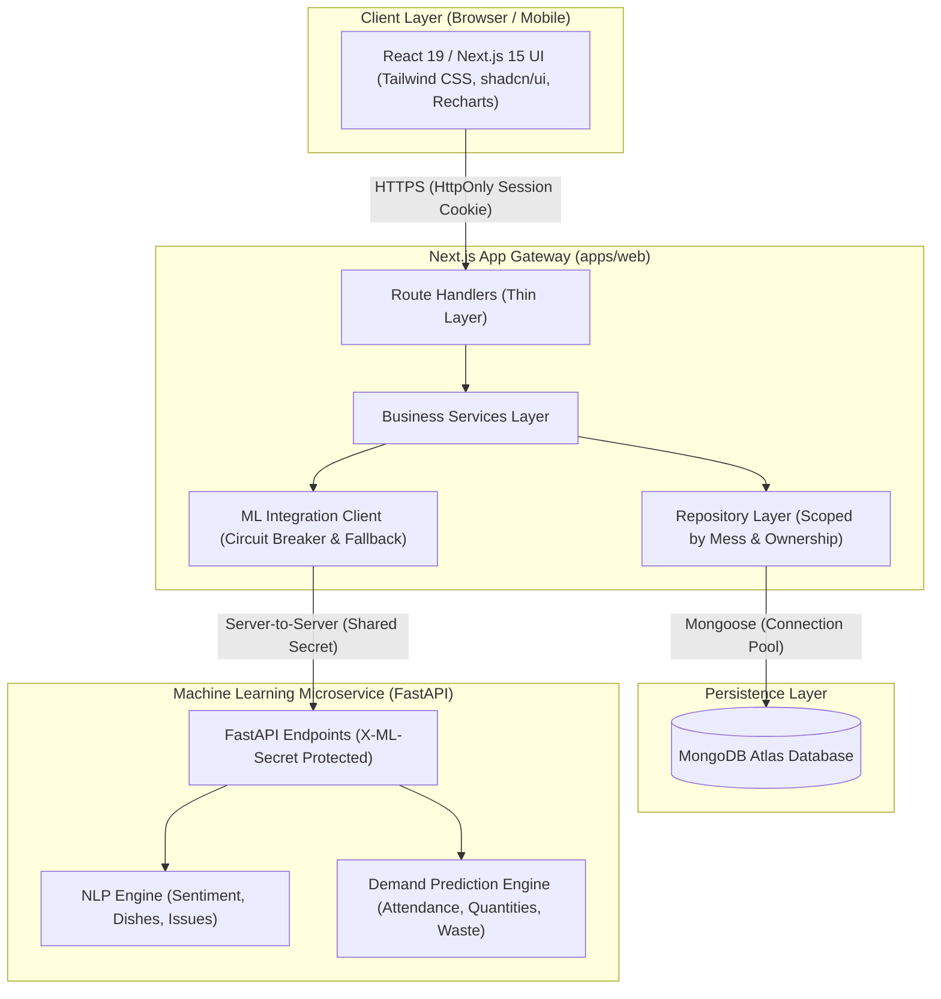

# MessInsight - System Architecture Document

## 1. System Overview

MessInsight is an intelligent mess and canteen feedback system with demand prediction designed for educational institutions and hostel campuses.



---

## 2. Architectural Boundaries & Security Rules

1. **Strict 3-Tier Layering**:
   - **Route Handlers (`src/app/api/...`)**: Parse requests, validate input via Zod, invoke services, return standard responses. Thin controllers only.
   - **Service Layer (`src/server/services/...`)**: Enforce all domain logic, authorization, ownership, transaction boundaries, and state transitions.
   - **Repository Layer (`src/server/repositories/...`)**: Pure database queries. Every query must accept explicit mess/student scope. Never contains business decisions.
   - **UI Components**: Pure client presentation. Never import or communicate with the DB directly.

2. **Network Isolation for ML**:
   - Direct browser calls to the ML service are forbidden.
   - Closed CORS policy on the ML service.
   - Communication is strictly server-to-server with `X-ML-Secret` header validation and correlation ID propagation.

3. **Zero-Trust Client Identity**:
   - Clients never supply trusted `userId`, `role`, or `messId` in request bodies.
   - The session cookie is verified on every request; identity and role are derived strictly on the server.

4. **Resilience & Fallback**:
   - If the ML service is unreachable or errors out, the main web application remains 100% operational.
   - Sentiment analysis queues or enters `PENDING` state.
   - Demand prediction seamlessly falls back to historical averages with visible UI indicator (`FALLBACK`).

---

## 3. Directory Structure

```text
messinsight/
  ├── apps/
  │   └── web/                     # Next.js 15 Web Application
  │       ├── src/
  │       │   ├── app/             # App Router pages and route handlers
  │       │   ├── components/      # Reusable UI, layouts, charts, forms
  │       │   ├── lib/             # Client-side API client and utilities
  │       │   ├── server/          # Server-only domain code
  │       │   │   ├── config/      # Validated environment configuration
  │       │   │   ├── lib/         # Core utilities (errors, logger, response, apiHandler)
  │       │   │   ├── middleware/  # Auth, RBAC, ownership guards
  │       │   │   ├── models/      # Mongoose schemas
  │       │   │   ├── repositories/# Data access layer
  │       │   │   ├── services/    # Business logic
  │       │   │   └── validators/  # Zod validation schemas
  │       │   └── tests/           # Unit and integration test suites
  │       ├── package.json
  │       └── vitest.config.ts
  ├── services/
  │   └── ml-service/              # FastAPI ML Microservice
  │       ├── app/                 # FastAPI entry point
  │       ├── api/                 # Endpoint routers
  │       ├── schemas/             # Pydantic schemas
  │       ├── services/            # NLP and prediction pipelines
  │       ├── preprocessing/       # Normalization & tokenization
  │       ├── evaluation/          # Model evaluation scripts
  │       ├── artifacts/           # Serialized models (.joblib)
  │       ├── datasets/            # Datasets and training registers
  │       └── tests/               # Pytest suite
  ├── docs/                        # Frozen contracts, OpenAPI, data dictionary
  ├── scripts/                     # Seed and maintenance scripts
  ├── .github/workflows/           # CI/CD workflows
  └── .env.example                 # Environment variable templates (no secrets)
```

