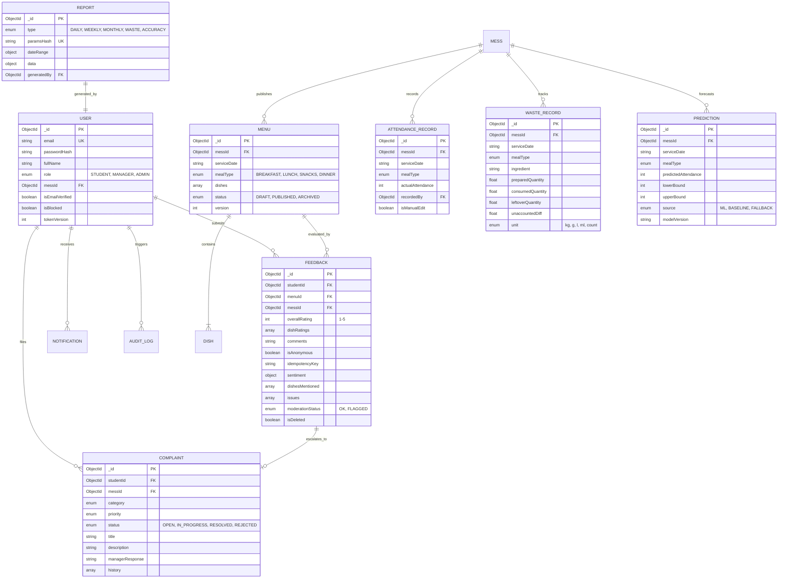

# MessInsight — Database Schema & Data Dictionary

## 1. Entity-Relationship Diagram (ERD)

---

## 2. Key Indexes & Constraints

1. **Unique Constraints**:
   - `User`: `{ email: 1 }`
   - `Menu`: `{ messId: 1, serviceDate: 1, mealType: 1 }`
   - `AttendanceRecord`: `{ messId: 1, serviceDate: 1, mealType: 1 }`
   - `WasteRecord`: `{ messId: 1, serviceDate: 1, mealType: 1, ingredient: 1 }`
   - `Report`: `{ type: 1, paramsHash: 1 }`
   - `Notification`: `{ userId: 1, eventKey: 1 }`

2. **Compound Query Indexes**:
   - `Feedback`: `{ messId: 1, serviceDate: 1, mealType: 1, isDeleted: 1 }`
   - `Feedback`: `{ studentId: 1, menuId: 1, isDeleted: 1 }`
   - `Prediction`: `{ messId: 1, serviceDate: 1, mealType: 1, generatedAt: -1 }`
   - `Complaint`: `{ messId: 1, status: 1, createdAt: -1 }`
   - `AuditLog`: `{ correlationId: 1, timestamp: -1 }`

