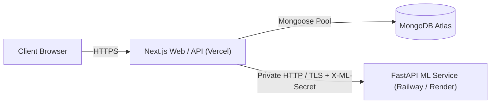

# MessInsight — Deployment & Operations Guide

## 1. Architecture Overview for Production

MessInsight consists of two independently deployable components:
1. **Web Application & API Gateway (`apps/web`)**: Next.js 15 App Router deployed to Vercel or Node.js container (AWS ECS / Railway / Render).
2. **ML Microservice (`services/ml-service`)**: Python 3.11 FastAPI service deployed to a container runtime (Railway / Render / AWS ECS / Google Cloud Run).
3. **Database**: MongoDB Atlas (Replica Set M10+ recommended for production).



---

## 2. Environment Variables Checklist

### Web App (`apps/web`)
| Variable | Description | Required | Example |
| :--- | :--- | :--- | :--- |
| `NODE_ENV` | Environment mode | Yes | `production` |
| `PORT` | Local server port | No (default: 3000) | `3000` |
| `NEXT_PUBLIC_APP_URL` | Base canonical application URL | Yes | `https://messinsight.college.edu` |
| `MONGODB_URI` | MongoDB connection string | Yes | `mongodb+srv://...` |
| `JWT_SECRET` | 32+ char secret for JWT signing | Yes | `min-32-chars-cryptographically-secure` |
| `JWT_EXPIRES_IN` | Token duration | No (default: 7d) | `7d` |
| `COOKIE_NAME` | HttpOnly session cookie name | No | `messinsight_session` |
| `INSTITUTE_EMAIL_DOMAIN` | Allowed institutional email domain | Yes | `college.edu` |
| `MESS_TIMEZONE` | Institute local timezone | No | `Asia/Kolkata` |
| `ML_SERVICE_URL` | Base URL for Python ML service | Yes | `https://ml.internal.college.edu` |
| `ML_SERVICE_SECRET` | Shared secret header (`X-ML-Secret`) | Yes | `super-secret-ml-key-change-me` |
| `EMAIL_PROVIDER` | Email driver (`console`, `smtp`, `resend`)| Yes | `smtp` |
| `EMAIL_FROM` | From sender address | Yes | `messinsight@college.edu` |
| `STORAGE_PROVIDER` | File storage (`local`, `s3`) | Yes | `s3` |

### ML Microservice (`services/ml-service`)
| Variable | Description | Required | Example |
| :--- | :--- | :--- | :--- |
| `PORT` | Container listen port | No (default: 8000) | `8000` |
| `ML_SERVICE_SECRET` | Must match Web App's `ML_SERVICE_SECRET` | Yes | `super-secret-ml-key-change-me` |
| `ENV` | Environment mode | No | `production` |

---

## 3. Step-by-Step Deployment Instructions

### A. ML Microservice (FastAPI on Docker / Railway)

1. **Dockerfile (`services/ml-service/Dockerfile`)**:
```dockerfile
FROM python:3.11-slim
WORKDIR /app
COPY requirements.txt .
RUN pip install --no-cache-dir -r requirements.txt
COPY . .
EXPOSE 8000
CMD ["uvicorn", "app.main:app", "--host", "0.0.0.0", "--port", "8000"]
```

2. Build and verify locally:
```bash
docker build -t messinsight-ml:latest ./services/ml-service
docker run -p 8000:8000 -e ML_SERVICE_SECRET="production-secret" messinsight-ml:latest
```

3. Health Probe:
```bash
curl http://localhost:8000/health
# Response: {"status":"UP","service":"messinsight-ml-service","models_loaded":true}
```

### B. Web App (Next.js 15 on Vercel)

1. Connect the GitHub repository to Vercel.
2. Set Root Directory to `apps/web`.
3. Configure all environment variables in Vercel project settings.
4. Deploy branch `main`.

---

## 4. Health Checks, Monitoring & Rollback Strategy

1. **Health Endpoints**:
   - Web App: `GET /api/health`
     - Evaluates database connectivity and ML service circuit breaker status (`UP`, `DEGRADED`, `DOWN`).
   - ML Service: `GET /health`
     - Evaluates model loading status in memory.

2. **Zero-Downtime Rollback**:
   - Vercel: One-click instant rollback to previous deployment hash.
   - Railway / Containers: Re-tag container image to previous release SHA and redeploy.
   - Database Migrations: Mongoose schema changes must be backward-compatible (all new model fields optional with sensible defaults).

