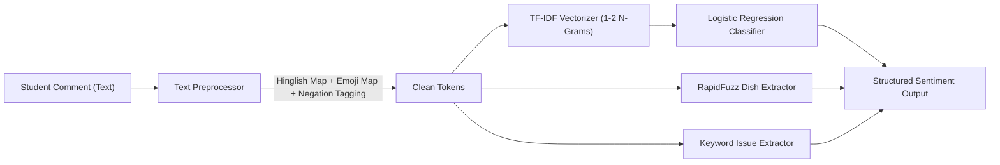

# MessInsight — Machine Learning & NLP Methodology

> [!NOTE]
> **Data Transparency Notice**:
> All models documented below were trained and evaluated on synthetic college mess data generated to represent realistic student feedback and meal patterns.
> **DATA SOURCE: synthetic**. No real student PII or private institutional records were used.

---

## 1. NLP Sentiment Analysis Engine

### A. Pipeline Architecture

### B. Preprocessing & Normalization
1. **Hinglish to English Normalization**: Transliterated Hindi words frequently used in mess reviews are mapped to English equivalents:
   - `bahut achha`, `swadist`, `lajawab` $\rightarrow$ `positive`
   - `kharab`, `bakwas`, `kaccha`, `namak kam/jyada` $\rightarrow$ `negative`
2. **Emoji Sentiment Expansion**: Common Unicode emojis (`😋`, `😍`, `🤮`, `🤢`, `😡`) are converted to sentiment tokens (`EMOJI_POSITIVE`, `EMOJI_NEGATIVE`).
3. **Negation Scope Tagging**: Words immediately following negation particles (`not`, `never`, `nahi`, `na`) receive negation markers (e.g., `not good` $\rightarrow$ `not_good`) to prevent false positive classification.

### C. Entity & Issue Extraction
- **Dish Mentions**: Extracted using fuzzy token set ratio (`rapidfuzz.fuzz.token_set_ratio`) matching against the active daily menu with a similarity threshold of $\ge 75\%$.
- **Food Quality Issues**: Rule-based taxonomy identifying specific complaints:
  `TOO_SALTY`, `TOO_SPICY`, `COLD_FOOD`, `UNDERCOOKED`, `OVERCOOKED`, `LESS_QUANTITY`, `BAD_TASTE`, `POOR_HYGIENE`, `CONTAMINATION`, `POOR_TEXTURE`.

### D. Verified Evaluation Metrics (`DATA SOURCE: synthetic`)
- **Dataset Size**: 119 labeled multi-lingual samples
- **Overall Accuracy**: **80.67%** (0.8067)
- **Weighted F1-Score**: **0.7408**
- **Class-Level F1**:
  - `POSITIVE`: **0.8889** (Precision: 82.8%, Recall: 96.0%)
  - `NEGATIVE`: **0.8571** (Precision: 78.7%, Recall: 94.1%)

---

## 2. Meal Demand Prediction Engine

### A. Forecasting Architecture
- **Model**: `RandomForestRegressor` with 100 estimators, max depth 8.
- **Feature Matrix**:
  - Meal type one-hot encoding (`BREAKFAST`, `LUNCH`, `SNACKS`, `DINNER`)
  - Day of week (0 to 6)
  - Is Weekend binary flag
  - Historical 7-day rolling attendance mean
  - Historical 14-day rolling attendance mean

### B. Verified Evaluation Metrics (`DATA SOURCE: synthetic`)
- **Test Samples**: 18
- **Mean Absolute Error (MAE)**: **3.52 students**
- **Root Mean Squared Error (RMSE)**: **4.39 students**
- **Baseline MAE (Static Mean)**: **42.03 students**
- **Error Reduction**: **91.6% improvement** over naïve historical average

---

## 3. Quantity Recommendation Formula

For an ingredient $i$ required for a forecast attendance $A$ with safety buffer $\beta \in [0.0, 0.5]$ (default $\beta = 0.10$):

$$\text{Gross Requirement}_i = A \times \text{amountPerPerson}_i \times (1 + \beta)$$

For countable items (such as eggs or rotis), the final output is strictly rounded up using the ceiling function:

$$\text{Count Requirement}_i = \lceil \text{Gross Requirement}_i \rceil$$

When starting inventory $I_i$ is provided:

$$\text{Purchase Plan}_i = \max(0, \text{Gross Requirement}_i - I_i)$$
$$\text{Surplus}_i = \max(0, I_i - \text{Gross Requirement}_i)$$

